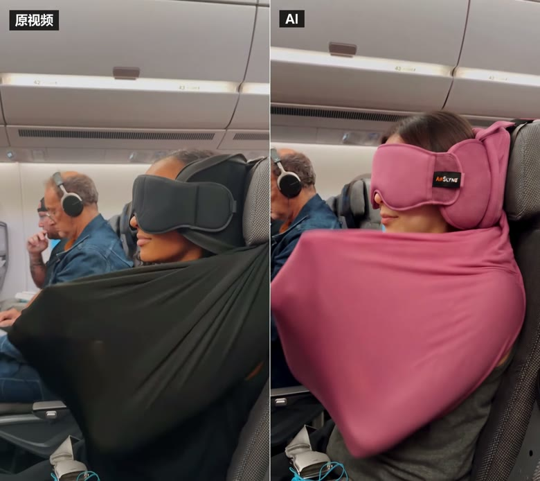

# Renoise 带货视频复刻 Skill

用一条参考视频保留机位、动作和节奏，换成自己的人物和商品，再生成带标注的左右对照。人物和商品参考图由 Codex 的 ImageGen 制作。视频由 Renoise MCP 生成。

## 实测对照视频

[在 GitHub 查看对照视频](assets/airslyng-comparison.mp4) · [直接下载 MP4](https://raw.githubusercontent.com/10291124jcjc-dotcom/guiji-renoise-remake/main/assets/airslyng-comparison.mp4)

AirSlyng 案例。左边是原视频，右边是 MAGI-2 生成的粉色复刻。对照共 8 秒，1440 × 1280，保留原视频音轨。[原视频、商品和制作过程](references/airslyng-example.md)

## 安装与运行

1. 把本仓库目录放到 `~/.codex/skills/guiji-renoise-remake`，保留 `SKILL.md`、`references/` 和 `scripts/` 的相对位置。
2. 按 [Renoise MCP 安装说明](references/renoise-setup.md)连接账号。导出对照需要 Python、FFmpeg 和 ffprobe。
3. 在 Codex 中调用 `$guiji-renoise-remake`，提供原视频、商品链接和想改的地方。生成前先确认参考图、模型和报价。

[查看完整 Skill](SKILL.md)
